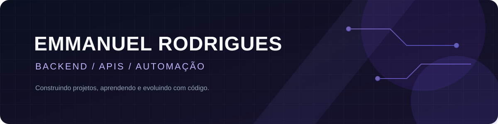

  

  <strong>Desenvolvedor em formação · Backend · APIs · Automação</strong>

  <a href="https://emmanuel-portfolio-blue.vercel.app">Portfólio</a> ·
  <a href="https://github.com/nunogues/nunogues/tree/main/site">Código-fonte do portfólio</a> ·
  <a href="https://github.com/nunogues?tab=repositories">Projetos</a> ·
  <a href="https://github.com/nunogues">GitHub</a>

---

## Sobre

Tenho interesse em desenvolvimento backend e na criação de ferramentas úteis. Gosto de trabalhar com APIs, integração entre serviços e automação, aprendendo por meio de projetos práticos.

## Tecnologias

  

  
  
  

## Projetos em destaque

| Projeto | Descrição | Stack |
|---|---|---|
| [G1 API](https://github.com/nunogues/g1api-unofficial) | API REST não oficial que organiza notícias do G1 em JSON, com busca e cache. | Python · FastAPI |
| [PingChecker](https://github.com/nunogues/apicheck) | API para consultar disponibilidade, status HTTP e tempo de resposta de sites. | Python · FastAPI · HTTPX |
| [Simple PPT](https://github.com/nunogues/simple-ppt) | Lógica de Pedra, Papel e Tesoura com escolha aleatória e pontuação. | JavaScript · Node.js |

## Atualmente

- Aprofundando conhecimentos em Python e JavaScript.
- Estudando desenvolvimento backend e integração de APIs.
- Melhorando a qualidade dos projetos com testes e documentação.

---

  Projetos independentes e experimentos de aprendizagem. Cada repositório descreve seu escopo e suas limitações.

